# Knight Watch

Knight Online oynarken çanta doluluğunu, bağlantı kesilmesini ve farm kazancını takip edin. Windows uygulaması oyun penceresini izler. Siz de Telegram’dan uyarı alabilir, farmı tarayıcıdan paylaşabilir veya Android uygulamasından takip edebilirsiniz.

[**Windows için indir (.exe)**](https://github.com/umutkocakaya/knightwatch/releases/latest/download/KnightWatch.exe) · [**Android için indir (.apk)**](https://github.com/umutkocakaya/knightwatch/releases/download/android-latest/KnightWatch.apk) · [**Windows sürümleri**](https://github.com/umutkocakaya/knightwatch/releases/latest)

**[Windows kurulumu](#1-windows-kurulumu)** · **[Telegram](#2-telegram-bildirimleri)** · **[Farm ve log seçimi](#3-farma-başlama-ve-izleme)** · **[Web paneli](#4-web-paneli)** · **[Android](#5-android-uygulaması)** · **[Sorun giderme](#sorun-giderme)**

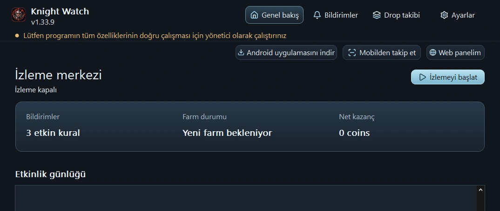

## 1. Windows kurulumu

1. Windows 10 (1903 veya sonrası) ya da Windows 11’in 64 bit sürümünde [KnightWatch.exe’yi indirin](https://github.com/umutkocakaya/knightwatch/releases/latest/download/KnightWatch.exe).
2. EXE’yi kalıcı bir klasöre koyun ve çift tıklayıp açın. Uygulama taşınabilir, ek kurulum gerektirmez.
3. Knight Online’ı açın ve karakterinizle oyuna girin. Oyun penceresi açık ve küçültülmemiş kalsın. Başlangıç için pencere veya kenarlıksız pencere modunu kullanın.
4. Uyarı almak istiyorsanız önce [Telegram bağlantısını](#2-telegram-bildirimleri) kurun. Farm sayımı için [oyun logunu seçin](#3-farma-başlama-ve-izleme).

| Yapmak istediğiniz | Açacağınız yer |
| --- | --- |
| Oyun görüntüsünü izlemeye başlamak | **Genel bakış → İzlemeyi başlat** |
| Botu bağlamak ve test mesajı almak | **Ayarlar → Telegram bağlantısı** |
| Uyarıları açmak ve sürelerini değiştirmek | **Bildirimler** |
| Farm başlatmak ve coins ile dropları görmek | **Drop takibi** |
| Aktif farmı tarayıcıda açmak | **Genel bakış → Web panelim** |
| Telefonu aktif farma bağlamak | **Genel bakış → Mobilden takip et** |

Ana pencerenin sağ üstündeki **×** düğmesi uygulamayı saat yanındaki bildirim alanına gizler. İzleme açıksa devam eder. Pencereyi geri getirmek için Knight Watch simgesine tıklayın. Tamamen kapatmak için simgeye sağ tıklayıp **Çıkış**’ı seçin.

## 2. Telegram bildirimleri

### Botu bağlama ve ilk testi gönderme

1. Knight Watch’ta **Ayarlar → Telegram bağlantısı → Kurulum rehberi** yolunu açın. Ayarları düzenlemek için izleme açıksa önce durdurun.
2. Telegram’da [resmî BotFather](https://t.me/BotFather) sohbetine `/newbot` gönderin. Botunuz için bir ad ve `bot` ile biten bir kullanıcı adı seçin. Verilen tokenı rehberdeki **Bot token** alanına yapıştırın.
3. Oluşturduğunuz **kendi botunuzun** sohbetini açın. **Başlat**’a basın ve `Merhaba` yazın. Botun yanıt vermesi gerekmez.
4. Rehberdeki **Chat ID sayfasını aç** düğmesine basın. Tarayıcıdaki yanıtta `message` içindeki `chat` bölümünü bulun ve `id` sayısını kopyalayın. Bu sayıyı uygulamadaki **Chat ID** alanına yapıştırın.
5. **Ayarları kaydet** ve ardından **Telegram testi gönder** düğmesine basın. Test mesajı kendi botunuzdaki sohbete geldiyse bağlantı hazırdır.

`result: []` görürseniz izlemeyi durdurun, kendi botunuza yeni mesaj gönderin ve Chat ID sayfasını yenileyin. `from.id` yerine `chat.id` değerini kullanın. Chat ID’yi gösteren tarayıcı adresi de bot tokenını içerir. Adresi ve ekran görüntüsünü özel tutun. [Telegram’ın bot oluşturma kılavuzu](https://core.telegram.org/bots/tutorial)

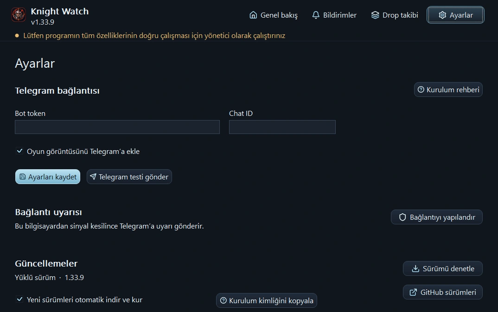

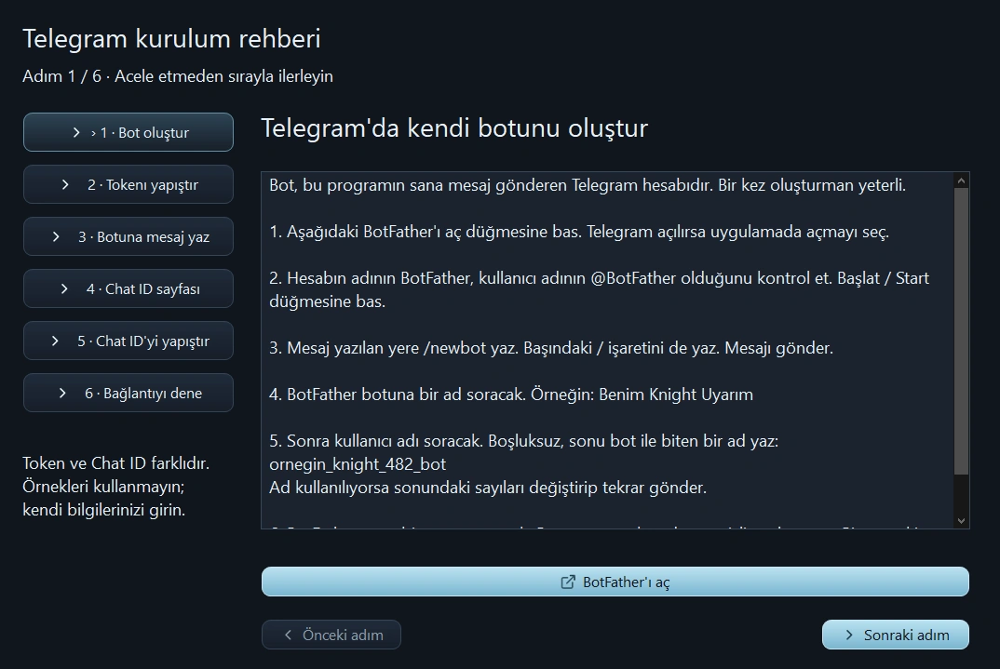

### Hangi durumda uyarı gelecek?

**Bildirimler** sekmesinde çanta doluluğu, sunucu bağlantısının kesilmesi ve yeniden doğma uyarılarını göreceksiniz.

1. Düzenleyeceğiniz kuralı tablodan seçin. **Aç / kapat** ile kuralın durumunu değiştirin.
2. **İlk uyarı (sn)** alanına koşulun kaç saniye görünmesi gerektiğini girin.
3. **Tekrar (dk)** alanına uyarılar arasındaki süreyi girin. `0` her olay için tek mesaj gönderir. Uyarıda kullanılacak metni **Telegram mesajı** alanından düzenleyebilirsiniz.
4. **Değişikliği kaydet** düğmesine basın ve **Genel bakış → İzlemeyi başlat** yoluyla izlemeyi açın.

**Benzerlik (%)** alanı ekrandaki görüntünün kayıtlı örneğe ne kadar benzemesi gerektiğini belirler. İlk kurulumda hazır değerleri kullanın. Özel kural eklemek için **Görsel ekle** ile bir oyun ekran görüntüsü açın ve yalnızca ilgili simgeyi veya uyarı alanını seçin.

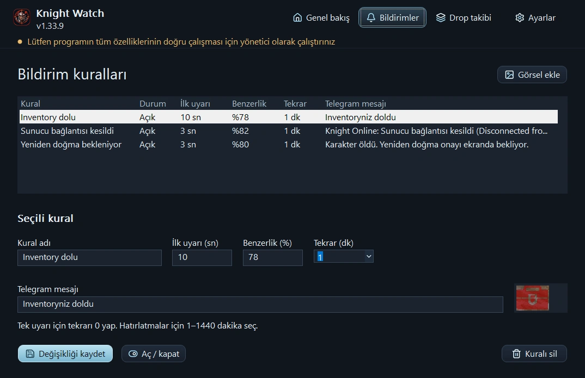

**Ayarlar** bölümünde **Oyun görüntüsünü Telegram’a ekle** seçeneği açıksa uyarıya ekran görüntüsü de eklenir. İzleme açıkken kendi botunuza `/ss` göndererek de oyun görüntüsü isteyebilirsiniz. Uyarı mesajındaki düğmelerle uyarıyı erteleyebilir, koşul düzelene kadar susturabilir veya bildirimleri yeniden açabilirsiniz.

### İsteğe bağlı bilgisayar bağlantı uyarısı

Knight Watch’tan sinyal gelmemesi durumunda bir dış servisin sizi uyarmasını istiyorsanız **Ayarlar → Bağlantı uyarısı → Bağlantıyı yapılandır** yolunu açın.

1. Healthchecks.io’da bu bilgisayar için bir kontrol oluşturun. **Period** değerini `1 dakika`, **Grace Time** değerini `2 dakika` yapın.
2. Healthchecks’in Telegram entegrasyonunu kontrolün projesine bağlayın.
3. Kontrolün `https://hc-ping.com/` ile başlayan **Ping URL** adresini Knight Watch’a yapıştırın ve **Kaydet ve dene**’ye basın. İlk sinyalin alındığını hem uygulamadan hem Healthchecks panelinden kontrol edin.

Planlı kapatma öncesinde kontrolü Healthchecks.io’da duraklatabilirsiniz. [Healthchecks kontrol ayarları](https://healthchecks.io/docs/configuring_checks/) · [Telegram entegrasyonu](https://healthchecks.io/integrations/telegram/)

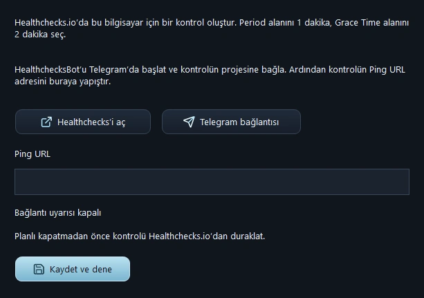

## 3. Farma başlama ve izleme

### Oyun logunu yerleştirme

Oyunda **sistem ve eşya mesajlarının** geldiği log penceresini açın. Aşağıdaki örnekte **All** seçili ve yeni satırlar altta akıyor. Logu sol tarafta, kısayol çubuklarının yanında tutup farm boyunca aynı konumda bırakabilirsiniz.

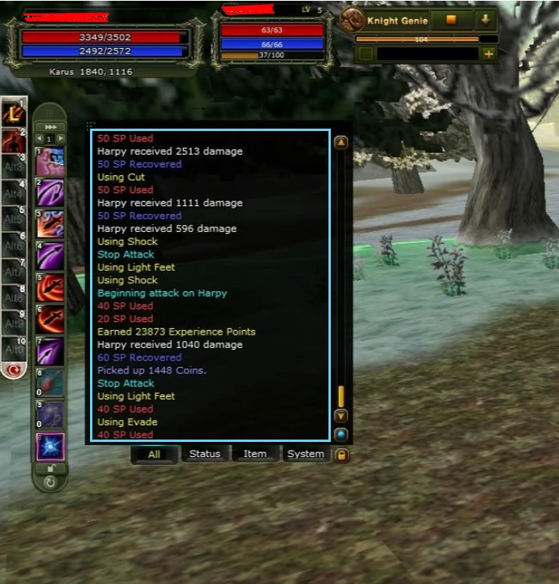

**Mavi çerçeve seçilecek yazı alanını gösterir.** En üstten en alta kadar görünen log satırları ve metinlerin sağa uzanabileceği boşluk seçime girsin. Sağdaki kaydırma çubuğunu, **All / Status / Item / System** düğmelerini, kısayol çubuklarını, can çubuklarını ve sohbet penceresini dışarıda bırakın. Alanı `Picked up … Coins` ve drop satırları kesilmeden okunabilecek genişlikte seçin.

### Knight Watch’a log alanını tanıtma

1. **Drop takibi → Ayarlar** bölümünü açın. **Coins ve item takibi açık** kutusunu işaretleyin ve oyun içindeki **kendi karakter adınızı** yazın.
2. **Log alanını seç**’e tıklayın. Oyun görüntüsü üzerinde yukarıdaki örneğe benzer bir dikdörtgen çizin ve **Seçimi onayla** düğmesine veya Enter’a basın.
3. **Log alanını gör** ile seçimi kontrol edin. Logun alt satırı, coins miktarı ve eşya adları tam görünmeli.
4. İsterseniz **PT arkadaşları** bölümünden bilinen oyuncuları ekleyin ve **İlk droptan itibaren saatlik Telegram özeti** seçeneğini açın.
5. **Ayarları kaydet**’e basın. Oyun içindeki logun konumu veya boyutu değişirse alanı yeniden seçin.

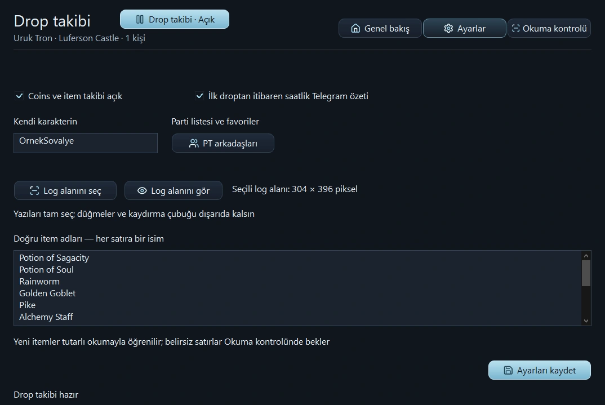

### Oturumu başlatma

1. **Drop takibi → Genel bakış → Farma başla** düğmesine basın. Kestiğiniz canavarı ve konumu arayıp listeden seçin.
2. **Parti büyüklüğü** ayarını seçin. **Otomatik · Oyun logundan** seçeneğini kullanabilir veya kişi sayısını belirtebilirsiniz. **Çantandaki coins** isteğe bağlı başlangıç tutarıdır.
3. Telefonda takip edecekseniz penceredeki QR kodunu Android uygulamasında okutun veya farm kodunu girin. Bağlantı hazırlanıyorsa kod hazır olduğunda alanda belirir.
4. Pencerenin sağ altındaki **Farma başla** ile seçimi onaylayın. Ardından **ana menü → Genel bakış → İzlemeyi başlat** düğmesine basın. Oyun açık kalsın ve log en altta, yeni satırlar görünür konumda dursun.
5. Oyun loguna yeni bir coins veya drop satırı düştüğünde **Drop takibi → Genel bakış** bölümünde sayımın ilerlediğini kontrol edin. Bitirirken **Farmı bitir**’e basın.

İzleme başladığında ekranda duran eski log satırları geçmiş sayılır. Sayaç yeni satırlar geldikçe artar.

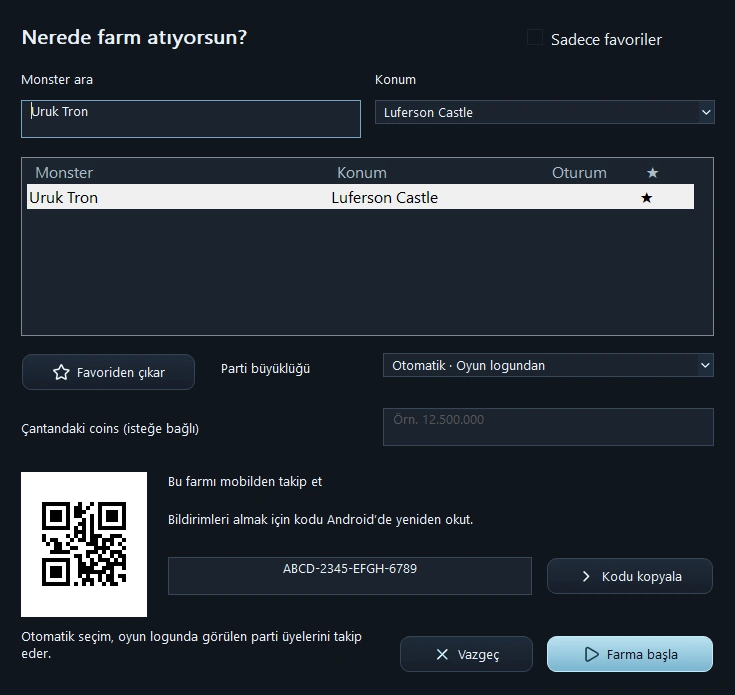

### Kazancı ve dropları okuma

- **Net kazanç**, farm coins’ine Sundries satışlarını ekler ve Sundries alışlarını düşer. Başlangıç coins’i ayrı gösterilir. **24 saatlik tahmin**, izlenen farm hızından hesaplanır.
- **Yıldız ekle…** ile önemli eşyaları işaretleyin. Yıldızlı eşya geçmişinden kime ne zaman düştüğünü görebilirsiniz.
- İsim veya sayı hatalı görünüyorsa **Okuma kontrolü**’nü açın. Doğru oyuncuyu ve eşya adını seçip **Düzelt ve say** ile kaydı ekleyin. İlgisiz satırları **Seçileni yoksay** ile kapatabilirsiniz.

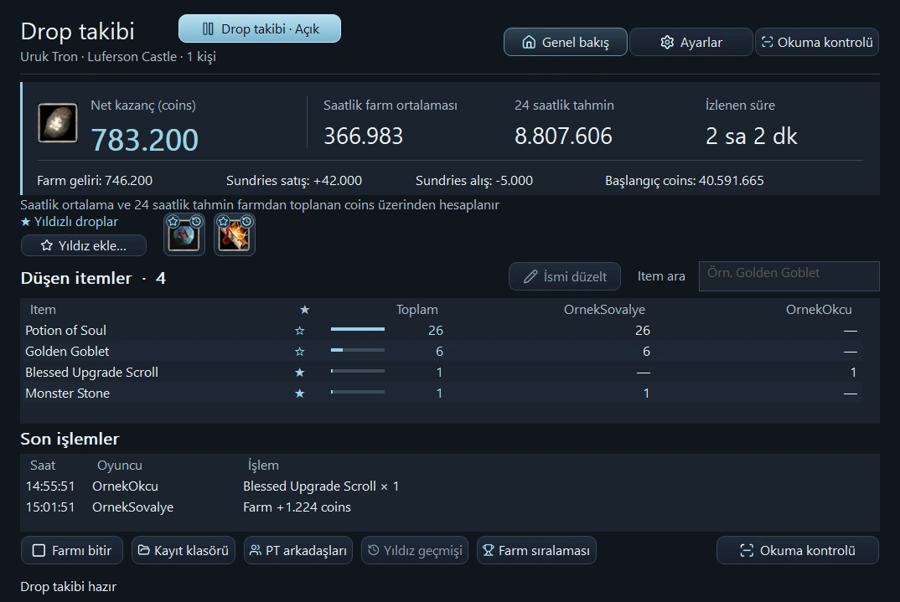

## 4. Web paneli

1. Windows’ta bir farm başlatın ve **Genel bakış → Web panelim** düğmesine basın. Yeni oturum bağlantısı hazırlanıyorsa kısa süre sonra tekrar açın.
2. Tarayıcıda **Genel bakış** ile kazancı, izlenen süreyi ve yıldızlı dropları görün. **Droplar** sekmesinde oyuncu adını açıp eşyaya göre arayın. **İşlemler** sekmesi son kayıtları gösterir.
3. **Paylaş** düğmesiyle veya adres çubuğundaki tam bağlantıyı kopyalayarak farmı paylaşabilirsiniz. Bağlantıyı açan kişi telefon veya bilgisayar tarayıcısından aktif farmı görebilir.

Web bağlantısı aktif farma özeldir. Yeni bir farm için Windows’tan yeni bağlantıyı alın. Bağlantıyı bilen kişiler farm istatistiklerini görebildiği için yalnızca paylaşmak istediğiniz kişilere gönderin.

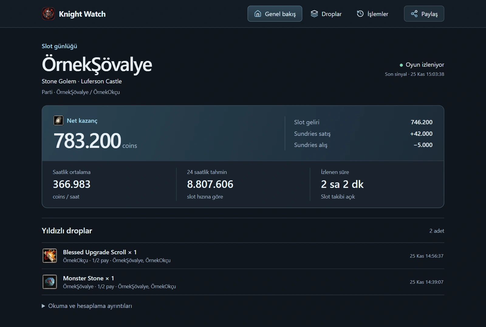

Telefon tarayıcısında oyuncuya göre dropları göster

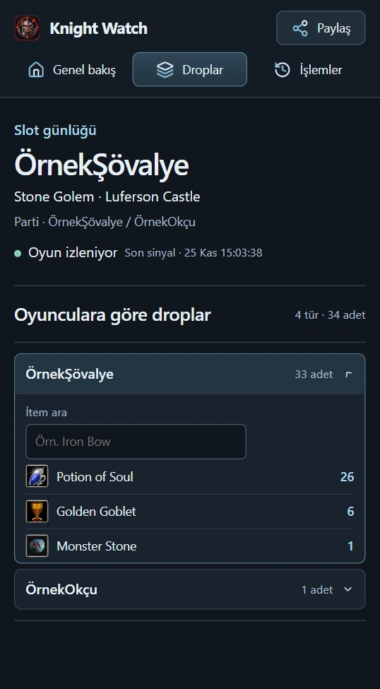

## 5. Android uygulaması

### APK’yı kurma ve farma bağlanma

1. Android telefonda [KnightWatch.apk’yı indirin](https://github.com/umutkocakaya/knightwatch/releases/download/android-latest/KnightWatch.apk). Windows’ta **Genel bakış → Android uygulamasını indir** düğmesindeki indirme QR’ını da telefon kamerasıyla açabilirsiniz.
2. İndirilen dosyayı açıp kurulumu onaylayın. Android izin isterse APK’yı açtığınız tarayıcı veya dosya yöneticisi için **Bilinmeyen uygulamaları yükle** iznini verin.
3. Windows’ta **Farma başla** penceresindeki veya **Genel bakış → Mobilden takip et** ekranındaki **farm QR kodunu** açın.
4. Android uygulamasında **QR kodunu okut**’a basıp farm QR’ını tarayın. Android sorarsa kamera iznini verin. Manuel bağlantı için **Farm kodu** alanına kodu yazıp **Bağlan**’a basın.
5. Bildirim iznini verin. Windows’ta **Mobilden takip et → Android testi gönder** ile sesi ve bildirimin telefona geldiğini kontrol edin.

**İndirme QR’ı** APK dosyasını açar. **Farm QR’ı** Android uygulamasını aktif farma bağlar. Farm tamamlandığında sonraki farmı takip etmek için yeni kodla bağlanın.

### Canlı akış ve bildirim tercihleri

- Ana ekrandaki **Canlı akış** filtrelerinden yıldızlı drop, saatlik özet veya görmek istediğiniz uyarı türünü seçin.
- **Sağ üstteki dişli → Ayarlar** bölümünde telefona gelecek bildirim türlerini tek tek açıp kapatın. **Alarm aralığı** ve **Uyarı başına bildirim sınırı** seçenekleri tekrarlayan bildirimleri düzenler.
- Android izni kapalıysa **Ayarlar → Bildirim izni** bölümünden izin durumunu kontrol edin. Yeni APK için **Güncellemeleri denetle** düğmesi de bu ekrandadır.
- Aktif farmdayken üstteki **kamera simgesi** bilgisayardan oyun görüntüsü ister. **Saat simgesi** üzerinden **Farm geçmişi** ve **Pazar payları** açılır.

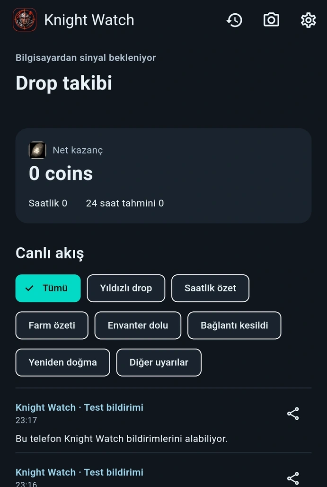 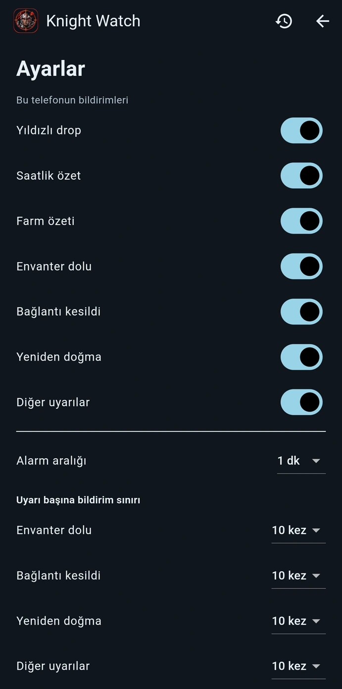

Bildirim izni, güncelleme ve geçmiş menüsünü göster

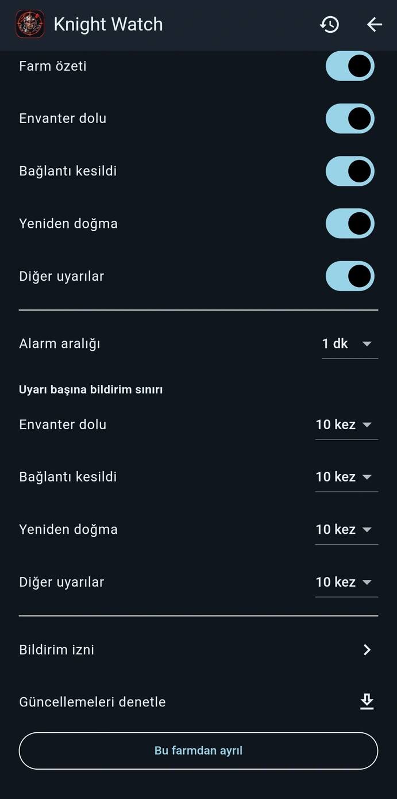 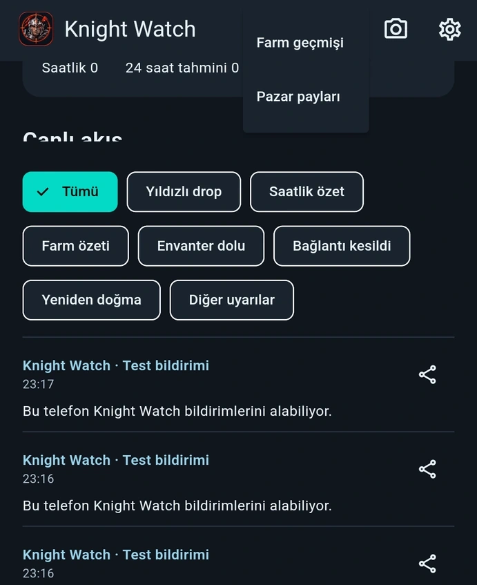

## Sorun giderme

| Belirti | Kontrol edin |
| --- | --- |
| **Telegram testi gelmiyor** | Kendi botunuzda Başlat’a basıp mesaj gönderdiğinizi, bot tokenını ve `chat.id` değerini kontrol edin. Windows’taki **Etkinlik günlüğü** gönderim hatasını gösterir. |
| **Oyun görüntüsü bekleniyor** | Oyunu küçültmeyin. Günlükte **Ön plan yedek yakalama** yazıyorsa oyunu ön planda tutun veya pencere modunda deneyin. Bilgisayar uyurken ya da ekran kilitliyken görüntü alınamayabilir. |
| **Coins veya drop sayılmıyor** | **İzlemeyi başlat** ve **Drop takibi** açık mı bakın. Farmı başlatın, logu en alta alın ve **Log alanını gör** ile yazıların tamamını kontrol edin. Belirsiz kayıtları **Okuma kontrolü**’nde inceleyin. |
| **Web bağlantısı açılmıyor** | Aktif bir farm olduğundan emin olup **Web panelim**’den güncel tam bağlantıyı açın. Eski farm bağlantılarının süresi dolabilir. |
| **Android’de bildirim gelmiyor** | Aktif farm koduyla bağlı olduğunuzu, ilgili uyarının uygulama ayarlarında açık olduğunu ve Android’in bildirim izni verdiğini kontrol edin. Windows’tan **Android testi gönder** ile deneyin. |
| **Windows sürümünü güncellemek istiyorum** | **Ayarlar → Güncellemeler → Sürümü denetle**’yi açın. Aynı bölümde otomatik güncellemeyi yönetebilirsiniz. |

### Paylaşmadan önce

Windows ayarları `%LOCALAPPDATA%\KnightWatch` altında saklanır. Bot tokenı Windows kullanıcı hesabına bağlı biçimde şifrelenir. Arkadaşlarınıza EXE ya da APK indirme bağlantısını verin. Ayar klasörünü, tokenı, Chat ID’yi ve Ping URL’yi özel tutun. Oyun ekran görüntülerinde karakter adları ve sohbetler bulunabilir.

*Görseller çalışan arayüzlerden alınmıştır. Windows ve web görsellerindeki oturum verileri örnektir. Android ekran görüntüleri gerçek bir RMX2170 cihazından alınmıştır.*
